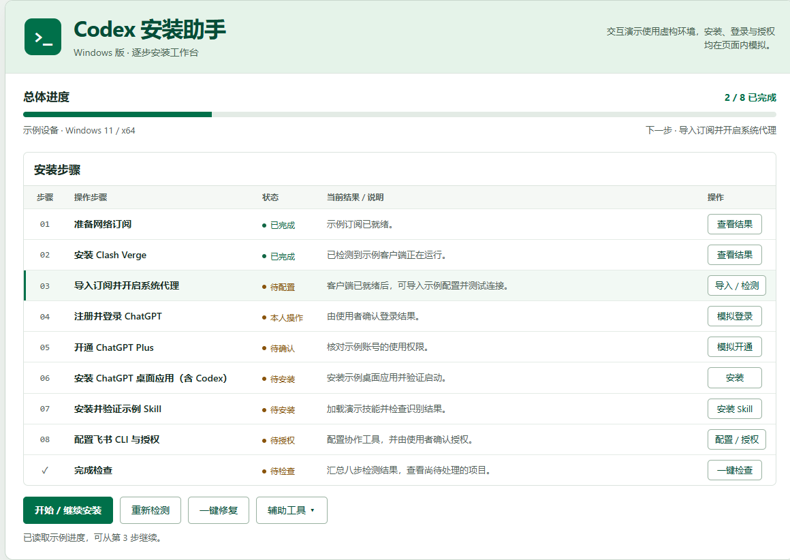

# Codex 安装助手 · Windows 逐步安装工作台

**[打开可操作的工作台 →](https://z-zz666.github.io/setup-assistant-demo/)**

页面按 Windows 版安装助手的布局重建。上方显示总进度，中间是八步安装表，每行都可以打开操作或查看结果。底部提供顺序引导、重新检测、一键修复和辅助工具。

| 想体验的操作 | 入口 |
| --- | --- |
| 从已有进度继续 | 点击「开始 / 继续安装」，从第 3 步逐项确认，最后查看总检结果。 |
| 体验完整八步 | 在「辅助工具」选择「从第一步体验」，切换到全新设备样例。 |
| 定位并修复故障 | 在「辅助工具」载入连接故障，点击「重新检测」，再选择「一键修复」并复查。 |
| 查看操作记录 | 在「辅助工具」打开「查看安装日志」。 |

所有状态都属于当前页面中的示例设备。无需下载、登录、付费或提供凭证。真实安装、网络配置、支付和授权均已替换为本地交互模拟。下载 `index.html` 后也可以离线体验。
